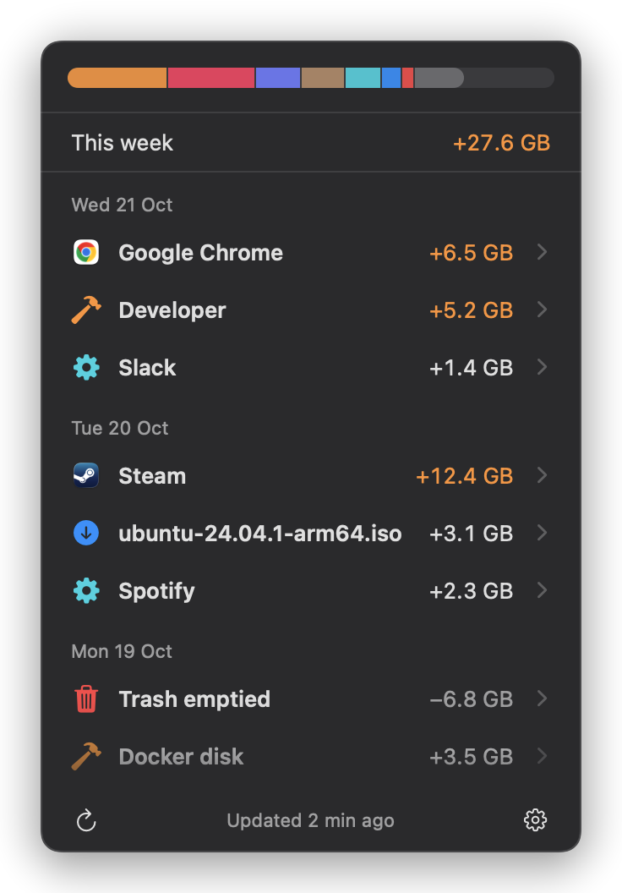
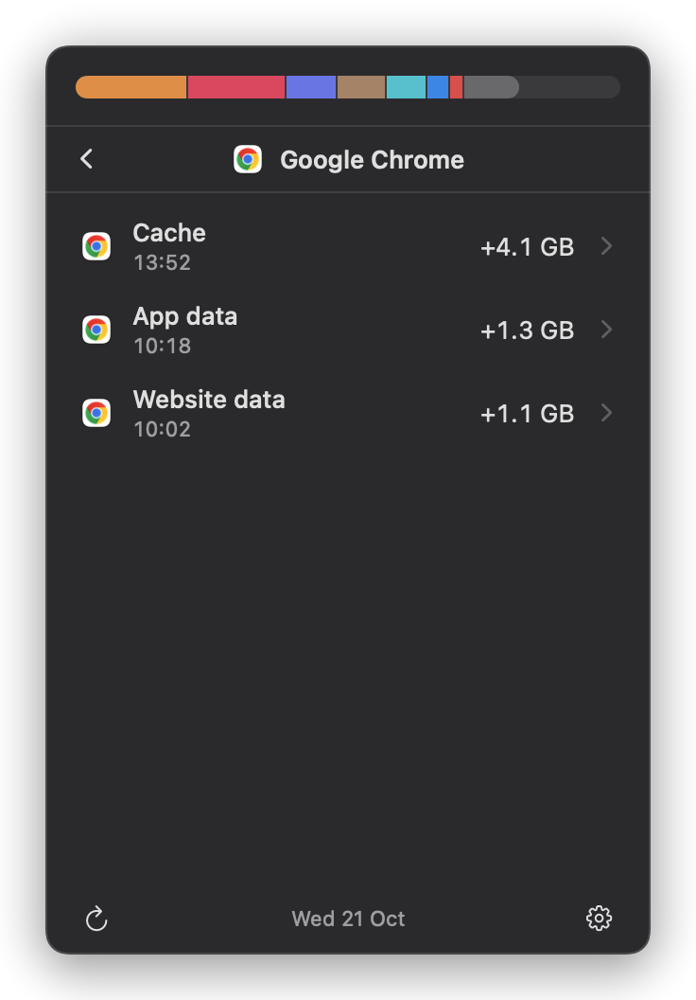
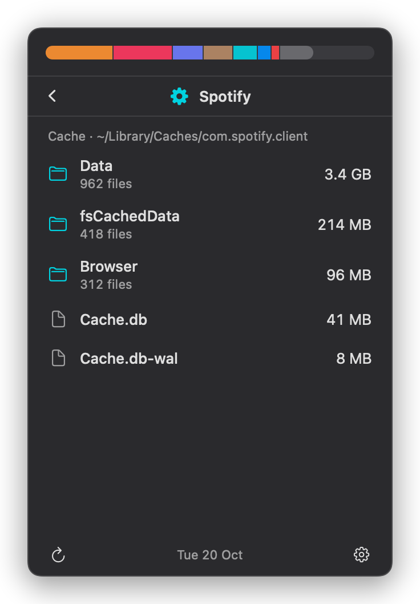
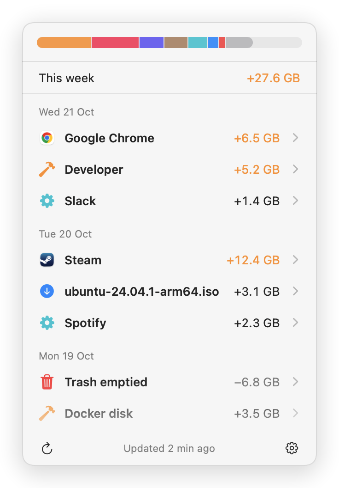

  

# Prunr

A macOS menu bar app that shows what ate your storage and when.

Prunr keeps a simple list of what grew on your disk, grouped by day and by app: "Google Chrome +6.5 GB", "Steam +12.4 GB". Click a row to see which folders it was, and click again to open them in Finder. On day one it rebuilds recent history from file dates, so the list isn't empty. Nothing leaves your Mac and there is no account.

Early beta: expect rough edges. Download the latest build from https://merlinkraemer.github.io/prunr/download.html or from [Releases](https://github.com/merlinkraemer/prunr/releases/latest). Updates arrive automatically.

  
  

  
  

License: source-visible during alpha. See [LICENSE](LICENSE). Docs index: [docs/README.md](docs/README.md).
